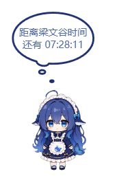
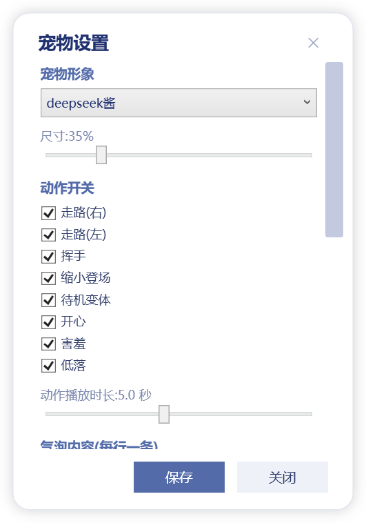

# PetdexPet 桌面宠物

一个双击即可运行在桌面上的小宠物(WPF 实现),基于 [Petdex](https://www.petdex.cn) 宠物包格式渲染,目前内置 **deepseek** 宠物形象。无需浏览器、无需 Petdex CLI,启动后宠物常驻桌面,支持动画、气泡对话、下班倒计时等玩法。

## 效果展示

待机时单击宠物,会冒出云朵状气泡(图为下班倒计时气泡):



设置窗口:尺寸、动作开关、气泡样式、倒计时全部可视化配置:



## 功能

### 动作系统
- **默认待机**:不操作时播放,眨眼循环
- **缩小登场**:启动时播放
- **随机动作**:每隔一段时间随机执行 走路(左/右)、挥手、待机变体
- **双击**:开心
- **长按**:害羞
- **长时间无交互**:低落
- 设置页可逐项开关上述动作;**动作播放时长**(1~10 秒)可调

### 云朵气泡
- 宠物头顶随机冒出云朵气泡,也可**单击宠物**触发
- 气泡内容多行自定义(每行一条,随机抽取);待机状态下才弹出
- 气泡大小、文字大小、显示时长、弹出频率(30 秒~10 分钟)均可设置

### 下班倒计时
- 设置下班时间(HH:mm)和倒计时文字(用 `{time}` 占位)
- 开启后**单击宠物**显示倒计时,每秒刷新;到点显示 `00:00:00`
- 可勾选"**常驻显示**",倒计时气泡固定在头顶,拖动宠物、关闭设置后自动恢复
- 平时气泡与倒计时气泡按弹出频率轮流出现

## 使用

1. 安装 [.NET 8 Desktop Runtime](https://dotnet.microsoft.com/download/dotnet/8.0)
2. 双击 `PetdexPet.exe`,宠物出现在桌面右下角
3. 右键宠物 → **设置...** 打开设置页;**退出** 关闭宠物

> 宠物素材(deepseek 精灵图)已内置在程序中,无需额外安装,双击即用。

## 设置项一览

| 设置项 | 范围 | 说明 |
| --- | --- | --- |
| 尺寸 | 10%~130% | 宠物在桌面上的大小 |
| 动作开关 | 开/关 | 逐项启用或禁用动作 |
| 动作播放时长 | 1~10 秒 | 挥手/开心/害羞/低落/待机变体的播放时长 |
| 气泡内容 | 每行一条 | 随机气泡文案 |
| 气泡大小 | 50%~200% | 云朵气泡整体缩放 |
| 文字大小 | 50~300 | 气泡文字字号 |
| 气泡显示 | 1~15 秒 | 气泡停留时长 |
| 气泡频率 | 30 秒~10 分钟 | 气泡弹出间隔 |
| 下班倒计时 | 开/关 | 单击宠物显示倒计时 |
| 常驻显示 | 开/关 | 倒计时气泡固定在头顶 |
| 下班时间 | HH:mm | 倒计时目标时刻 |
| 倒计时文字 | 含 `{time}` | 例如 `距离下班还有 {time}` |

所有设置在点击**保存**后写入 `%APPDATA%\PetdexPet\config.json`,重启保留;直接关闭设置页不保存。

## 技术实现

- WPF 透明置顶窗口(`AllowsTransparency` + `Topmost`),鼠标穿透气泡窗口
- 宠物包为 WebP 精灵图,使用 Magick.NET 解码为 PNG 后按 8 列 × 9 行(192×208)裁切帧
- 动画约定(行号 → 动作)为主机端规范,`DispatcherTimer` 逐帧驱动
- 云朵气泡样式移植自 [DeepSeek-Balance-Whale-Widget](https://github.com/MeteorNOX/DeepSeek-Balance-Whale-Widget)
- 配置持久化:`%APPDATA%\PetdexPet\config.json`

## 构建

```bash
dotnet build -c Release
# 产物: bin/Release/net8.0-windows/PetdexPet.exe
```
